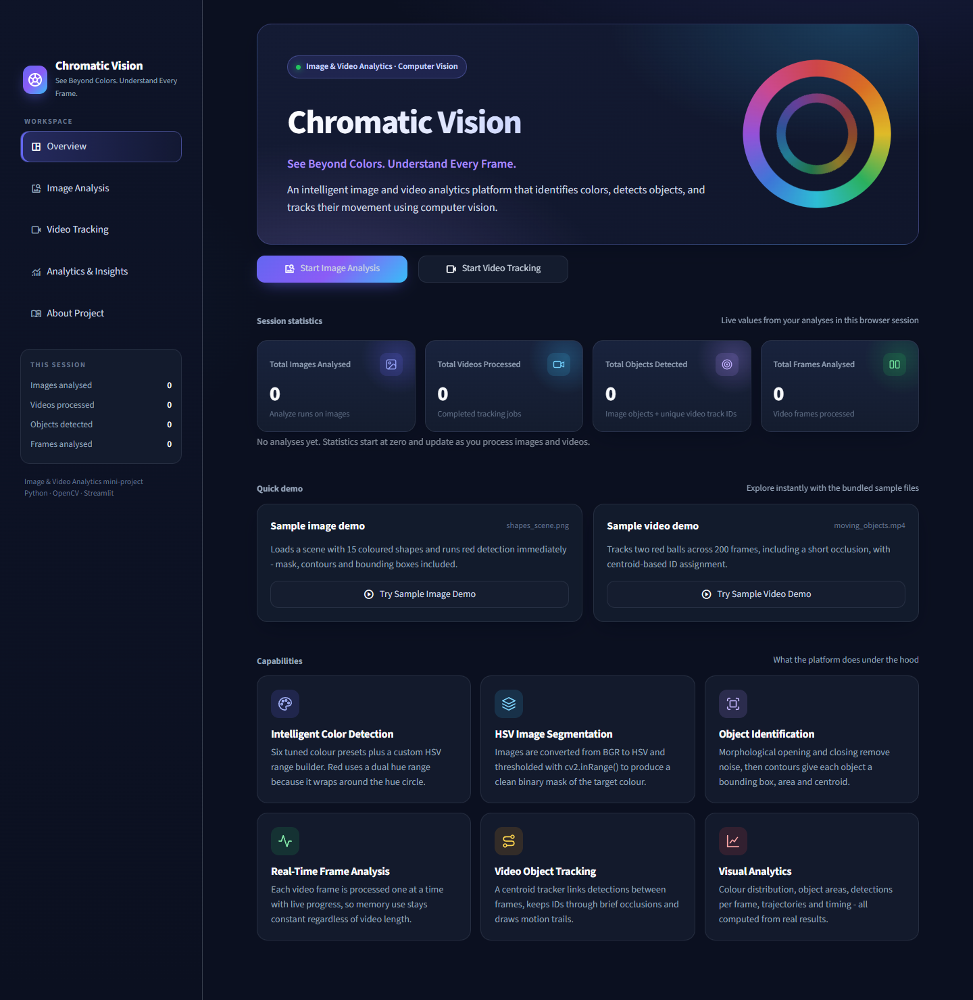

# Chromatic Vision

**See Beyond Colors. Understand Every Frame.**

*Intelligent Color Detection and Object Tracking Using Image Processing Techniques*. A B.Tech mini-project for **Image and Video Analytics**.

Chromatic Vision is a Streamlit web application that finds objects of a chosen colour in images and videos, measures them and tracks them from frame to frame. It uses only classical image processing: HSV segmentation, morphology, contours and centroid tracking. It does not use deep learning, cloud services or paid APIs.



---

## Features

| Area | What it does |
|---|---|
| **Overview dashboard** | Hero section, live session statistics (images, videos, objects, frames), one-click sample demos, feature cards |
| **Image Analysis Studio** | Drag-and-drop JPG/JPEG/PNG upload or bundled samples · 6 colour presets + custom HSV range · HSV fine-tuning sliders · morphology controls · binary mask, segmented image, all morphology stages · bounding boxes, centroids, object table · PNG/CSV downloads |
| **Video Tracking Studio** | MP4/AVI/MOV upload or samples · FPS, frame count, resolution, duration · browser preview · frame-by-frame processing with live progress · centroid tracking with IDs and motion trails · WebM + MP4 + CSV downloads |
| **Analytics & Insights** | Detection metrics, colour-distribution donut and bar charts, object-area chart, Matplotlib hue spectrum, objects per frame, processing time per frame, centroid trajectories, track lifetimes, session history |
| **About Project** | In-app documentation: introduction, problem, objectives, 14 techniques, workflow and architecture diagrams, methodology, algorithms, applications, limitations, future work |

All numbers and charts are computed from the actual processing results. No values are made up.

## Technology stack

Python 3.10+ · OpenCV · NumPy · Streamlit · Plotly · Matplotlib · Pillow

Tested with Python 3.12.10, streamlit 1.67.0, opencv-python-headless 5.0.0.93, numpy 2.5.4, plotly 7.1.0, matplotlib 3.11.2 and pillow 13.0.0 on Windows 10.

## Folder structure

```
chromatic_vision/
├── app.py                       # entry point: page config, CSS, routing
├── requirements.txt             # runtime dependencies
├── requirements-dev.txt         # + pytest, playwright (testing only)
├── .streamlit/config.toml       # dark theme, upload limit, hides default nav
├── modules/                     # computer-vision logic (no Streamlit code)
│   ├── color_ranges.py          # HSV presets, red dual range, helpers
│   ├── image_processing.py      # load → HSV → inRange → morphology → contours
│   ├── video_processing.py      # frame loop, tracking overlay, WebM/MP4 export
│   ├── object_tracking.py       # CentroidTracker
│   └── analytics.py             # colour distribution + Plotly/Matplotlib charts
├── components/                  # reusable UI pieces
│   ├── state.py                 # session state, navigation, temp-file cleanup
│   ├── sidebar.py               # brand, navigation, session summary
│   ├── color_picker.py          # colour palette + HSV sliders
│   └── ui_components.py         # icons, cards, headers, empty states, diagrams
├── views/                       # one module per page
│   ├── overview.py  image_studio.py  video_studio.py  analytics_page.py  about.py
├── styles/main.css              # custom theme
├── assets/
│   ├── logo.png
│   ├── sample_images/           # shapes_scene.png, ball_collection.jpg, neutral_scene.png
│   ├── sample_videos/           # moving_objects.mp4, orbiting_ball.avi
│   └── sample_ground_truth.json # exact object counts for the samples
├── outputs/
│   ├── samples/                 # example processed image, mask, videos, CSV
│   └── sessions/                # per-session temporary files (auto-cleaned)
├── scripts/
│   ├── generate_samples.py      # re-creates the synthetic sample media
│   ├── make_logo.py             # draws assets/logo.png
│   ├── make_report_assets.py    # diagrams, figures, sample outputs, measured results
│   └── capture_screenshots.py   # end-to-end UI test + screenshots (Playwright + Edge)
├── tests/                       # pytest suite (34 tests)
└── report/
    ├── project_report.md        # academic report
    ├── screenshots/  figures/   # real screenshots and generated figures
    ├── pytest_results.txt       # output of the last test run
    └── e2e_results.txt          # output of the last UI test run
```

## Installation (Windows)

```bash
cd chromatic_vision
```

```bash
python -m venv .venv
```

```bash
.venv\Scripts\activate
```

```bash
pip install -r requirements.txt
```

macOS/Linux: run `source .venv/bin/activate` instead of the activate command above.

## How to run

```bash
streamlit run app.py
```

Then open http://localhost:8501. The sidebar opens by default on desktop and starts collapsed on phones.

## Using the app

### Quick demo
On **Overview**, click **Try Sample Image Demo**. It loads `shapes_scene.png` and runs red detection straight away. **Try Sample Video Demo** loads `moving_objects.mp4` and starts tracking the red balls.

### Image analysis
1. Open **Image Analysis**. Choose **Upload image** and drag a JPG/PNG onto the drop zone, or choose **Sample image**.
2. Pick a **target colour** (Red, Orange, Yellow, Green, Blue, Purple) or choose **Custom** and set your own HSV ranges.
3. Optional: open **Fine-tune HSV thresholds** to change the hue range, minimum saturation and minimum brightness. For red you set a *hue spread*, which controls both ends of the hue circle.
4. Adjust the **kernel size**, **iterations** and **minimum object area** if needed.
5. Click **Analyze Image**. The tabs show the comparison, the masks, every morphology stage and the object table.

### Video tracking
1. Open **Video Tracking**. Upload an MP4/AVI/MOV file or pick a sample video. The video's information and a preview appear on the right.
2. Pick the target colour and set the tracking parameters:
   - *Minimum object area*: smaller blobs are ignored as noise.
   - *Max match distance*: how far a centroid can move between frames and still keep its ID.
   - *Frames to keep a lost ID*: how long a hidden object keeps its ID.
   - *Processing width*: large videos are scaled down to this width for speed.
   - *Frame limit*: process only the first N frames (0 = all frames).
3. Click **Process Video**. A progress bar and a live preview show while it runs. When it finishes you get the tracked video, the metrics and a chart of objects per frame.

### Downloading results
- Image: **Processed image** (PNG with boxes), **Binary mask** (PNG), **Segmented image** (PNG), **Objects (CSV)**.
- Video: **Processed video (WebM)** plays in browsers and VLC. **Processed video (MP4)** uses MPEG-4 Part 2 and plays in VLC and Windows Media Player. **Per-frame data (CSV)** is also available.

Example outputs are already in `outputs/samples/`.

## Testing

```bash
pip install -r requirements-dev.txt
```

```bash
python -m pytest tests -v
```

End-to-end UI test and screenshots. Start the app first in another terminal, and have Microsoft Edge installed:

```bash
python scripts/capture_screenshots.py
```

Last recorded results: **34/34 pytest tests passed** ([report/pytest_results.txt](report/pytest_results.txt)), **22/22 UI checks plus 1 mobile check passed** ([report/e2e_results.txt](report/e2e_results.txt)).

## Re-creating the sample media and figures

```bash
python scripts/generate_samples.py
```

```bash
python scripts/make_report_assets.py
```

## Troubleshooting

| Problem | Fix |
|---|---|
| `streamlit` is not recognised | Activate the venv first (`.venv\Scripts\activate`) or run `python -m streamlit run app.py`. |
| `ImportError: libGL` (Linux) | The project uses `opencv-python-headless`, which does not need libGL. Uninstall `opencv-python` if both are installed. |
| "Invalid image" error | The file is not a real JPG/PNG (for example a renamed file) or it is corrupted. Re-export it as PNG/JPG. |
| "Invalid video" error | OpenCV cannot decode that codec. Re-encode it to H.264 MP4, for example with VLC: *Media → Convert/Save*. |
| Uploaded video preview does not play | The preview is re-encoded to WebM. If that fails, the first frame is shown instead and processing still works. |
| Nothing is detected | Try another preset, lower *Minimum object area*, or widen the thresholds under *Fine-tune HSV thresholds*. Dim scenes need a lower minimum brightness. |
| Too many false detections | Raise the minimum saturation and brightness, increase the kernel size or raise *Minimum object area*. |
| Long or HD video is slow | Set *Processing width* to 640 px, or use *Frame limit* to process part of the video. |
| Port 8501 already in use | Run `streamlit run app.py --server.port 8502`. |
| MP4 download will not open in some players | Use the WebM download or open the MP4 in VLC. The MP4 uses the MPEG-4 Part 2 codec because H.264 (OpenH264) is not bundled with OpenCV on Windows. |

## Honest scope notes

- Tracking is **centroid matching**: greedy nearest-neighbour matching with a distance gate and a "disappeared" counter. It is not deep-learning or Kalman-filter tracking.
- The bundled sample images and videos are **synthetic**, drawn with OpenCV, so the exact ground truth is known. Real photos may need threshold tuning.
