<div align="center">

# CHROMATIC VISION

## Intelligent Color Detection and Object Tracking Using Image Processing Techniques

### A Mini-Project Report

submitted in partial fulfilment of the requirements for the course

**Image and Video Analytics**

Bachelor of Technology

<br>

**Submitted by**
Name: ____________________  Roll No.: ____________

<br>

**Under the guidance of**
____________________

<br>

Department of ____________________
____________________ (Institute name)
Academic Year 20__ – 20__

</div>

---

## Abstract

Colour is one of the simplest visual cues for finding objects in a scene. This project presents **Chromatic Vision**, a web application that detects objects of a chosen colour in images and videos, measures them, and tracks them across video frames using classical image processing only. Each image or frame is converted from the BGR colour space to HSV. A binary mask of the target colour is made with `cv2.inRange()`, and red uses two hue ranges because it wraps around the hue circle. The mask is cleaned with morphological opening and closing. Individual objects are then found with contour analysis, which gives a bounding box, an area and a centroid for each one. In videos, a centroid-based tracker links detections between consecutive frames and keeps object IDs through short occlusions. The application is built with Python, OpenCV, NumPy and Streamlit and includes interactive analytics made with Plotly and Matplotlib. It was tested with 34 automated unit tests and 23 automated browser checks. On the bundled sample images, the detected object counts matched the known ground truth for every colour tested. On the sample video, both red balls kept their IDs for all 200 frames, including a 9-frame period when one ball was hidden behind an obstacle. The average processing time was about 9–10 ms per 640×360 frame on a desktop CPU.

**Keywords:** HSV colour space, colour segmentation, morphological operations, contour detection, centroid tracking, OpenCV, Streamlit.

---

## Table of Contents

1. Introduction
2. Problem Statement
3. Objectives
4. Existing System
5. Proposed System
6. Software Requirements
7. Hardware Requirements
8. Technologies Used
9. System Architecture
10. Methodology
11. Algorithms
12. Image Processing Techniques
13. Implementation
14. Results and Discussion
15. Test Cases
16. Advantages
17. Limitations
18. Applications
19. Conclusion
20. Future Enhancements
21. References

---

## 1. Introduction

Image and video analytics is about extracting useful information from visual data automatically. Colour is a strong cue for many practical tasks, such as sorting fruit, counting coloured parts, following a ball or tracking a marker. Deep-learning detectors are powerful, but they need large labelled datasets and GPUs, and their decisions are hard to explain. For objects whose main feature is a distinct colour, classical colour segmentation is fast, transparent and needs no training.

Chromatic Vision puts this classical pipeline into an easy-to-use web application. A user uploads an image or video, picks a target colour and receives:

- a binary mask of the colour,
- bounding boxes, areas and centroids of every object,
- for videos, a processed video in which each object carries a tracking ID and a motion trail,
- analytics charts computed from the results,
- downloadable images, videos and CSV data.

Each step of the pipeline is also shown visually, so the application works as a teaching tool for the course topics.

## 2. Problem Statement

Manually locating and counting coloured objects in images, or following them through a video, is slow and error-prone. Thresholding directly on RGB values is unreliable, because a change in lighting changes all three channels at once. A practical solution must:

1. segment a colour robustly under normal lighting changes,
2. remove noise and fill holes in the segmented regions,
3. separate the mask into individual objects and measure each of them,
4. keep a consistent identity for each object across video frames, even when a detection is briefly missed,
5. present results in a way that a non-expert can use and understand.

## 3. Objectives

1. Detect objects of a user-selected colour using HSV colour segmentation.
2. Handle red correctly using two hue ranges.
3. Clean binary masks with erosion, dilation, opening and closing.
4. Identify objects through contour detection, bounding boxes and centroids.
5. Process videos frame by frame and track objects with centroid matching.
6. Provide visual analytics computed only from real processing results.
7. Allow downloading processed images, masks, videos and data.
8. Deliver a polished, responsive user interface and verify it with automated tests.

## 4. Existing System

| Approach | Drawbacks |
|---|---|
| Manual inspection and counting | Slow, subjective, does not scale to video |
| Fixed RGB thresholding scripts | Sensitive to shadows and highlights; no interface; results not visualised |
| Desktop tools (e.g. image editors with colour pickers) | Can select a colour, but cannot count objects, export data or track motion |
| Deep-learning detectors (e.g. YOLO-type models) | Need labelled data, training time and often a GPU; hard to explain; excessive when colour alone identifies the object |

Typical classroom implementations are command-line scripts that show an OpenCV window, with no parameter tuning, no analytics and no handling of invalid input.

## 5. Proposed System

Chromatic Vision is a browser-based application with five pages: **Overview**, **Image Analysis**, **Video Tracking**, **Analytics & Insights** and **About Project**.

Key properties:

- **HSV-based segmentation** with six tuned presets, a custom range mode and live slider tuning.
- **Dual-range red detection**: hue 0 to *s* OR hue (180 − *s*) to 179.
- **Configurable morphology**: kernel size, iterations and minimum object area.
- **Centroid tracker** with a distance gate and a disappearance counter.
- **Real analytics**: every chart is built from the current results and nothing is simulated.
- **Robust input handling**: invalid or empty files produce clear messages instead of crashes. Large images and videos are scaled down to limit memory use.
- **Sample demo mode** with synthetic images and videos whose ground truth is known exactly.

## 6. Software Requirements

| Item | Requirement |
|---|---|
| Operating system | Windows 10/11, Linux or macOS |
| Language | Python 3.10 or newer (developed and tested on 3.12.10) |
| Libraries | streamlit ≥ 1.50, opencv-python-headless ≥ 4.9, numpy ≥ 1.26, plotly ≥ 5.20, matplotlib ≥ 3.8, pillow ≥ 10.0 |
| Browser | Any modern browser (Edge, Chrome, Firefox) |
| Testing (optional) | pytest, playwright with Microsoft Edge |

## 7. Hardware Requirements

| Item | Minimum | Machine used for testing |
|---|---|---|
| Processor | Dual-core x64 CPU | AMD Ryzen 5 5600G (6 cores / 12 threads) |
| RAM | 4 GB | 16 GB |
| Storage | 1 GB free (including virtual environment) | SSD |
| GPU | Not required | Not used |

## 8. Technologies Used

| Technology | Role in the project |
|---|---|
| **Python** | Implementation language |
| **OpenCV** | Image decoding, colour conversion, thresholding, morphology, contours, moments, video reading and writing |
| **NumPy** | Pixel arrays, distance matrix for tracking, statistics |
| **Streamlit** | Web interface, widgets, session state, file upload and download |
| **Plotly** | Interactive charts (distribution, object areas, per-frame charts, trajectories, track lifetimes) |
| **Matplotlib** | Hue-spectrum histogram and report figures |
| **Pillow** | Reading file format and colour-mode information of uploads; image rendering inside Streamlit |
| **pytest / Playwright** | Automated unit tests and browser-based end-to-end tests |

## 9. System Architecture

The system has three layers (Figure 1). The **presentation layer** (Streamlit) contains the entry point `app.py`, reusable components, one module per page and a custom stylesheet. The **processing layer** (`modules/`) contains all computer-vision logic and does not depend on Streamlit, which makes it easy to test. The **foundation layer** is made up of the libraries and storage: session state for results, and a per-session folder for temporary files that is deleted automatically.

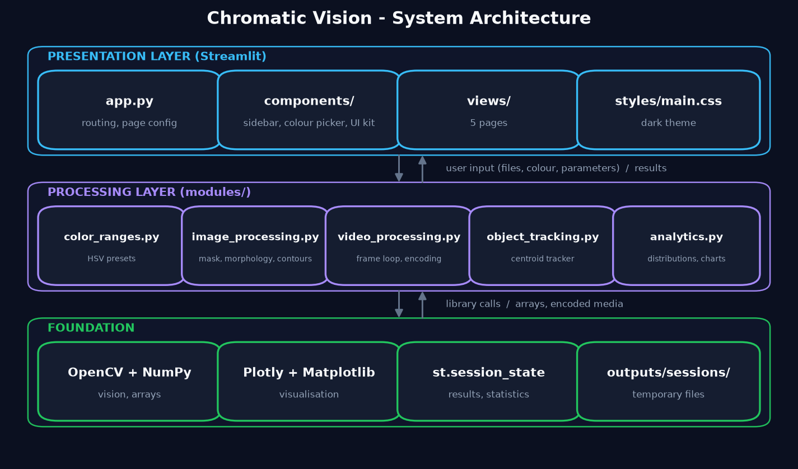

*Figure 1: System architecture of Chromatic Vision.*

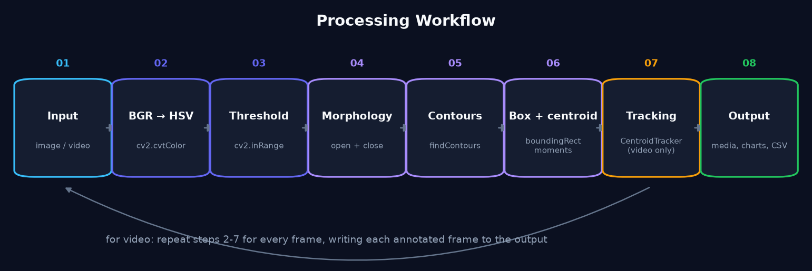

*Figure 2: Processing workflow. For videos, steps 2–7 run on every frame.*

## 10. Methodology

1. **Requirement study.** We identified the colour detection, tracking and analytics features needed for the course.
2. **Colour model selection.** We chose HSV over RGB. Hue holds the colour, while shading mainly changes Value.
3. **Threshold design.** We defined HSV ranges for six colours, using the OpenCV scale of H 0–179 and S, V 0–255. Red uses two ranges. Sliders allow tuning at run time.
4. **Noise handling.** We apply opening and then closing with an elliptical kernel, and discard contours below a minimum area.
5. **Object description.** For each contour we compute the bounding rectangle, the area and the centroid from image moments.
6. **Tracking design.** We match centroids greedily by nearest neighbour, with a maximum match distance and a "frames-to-keep-lost-ID" counter.
7. **Interface and analytics.** We built a five-page Streamlit app. Every chart reads from the stored result objects.
8. **Testing.** We generated synthetic samples with exact ground truth, then wrote pytest unit tests and Playwright end-to-end tests that click through the real UI.

## 11. Algorithms

### Algorithm 1 – Colour object detection

```
Input : image I (BGR), list of HSV ranges R, kernel size k, minimum area A
Output: list of objects (box, area, centroid), annotated image

1.  HSV  ← cvtColor(I, BGR→HSV)
2.  M    ← zero mask with the size of I
3.  for each (lower, upper) in R:            # 2 ranges for red, 1 otherwise
        M ← M OR inRange(HSV, lower, upper)
4.  M    ← morphologyEx(M, OPEN,  ellipse(k))  # remove noise
5.  M    ← morphologyEx(M, CLOSE, ellipse(k))  # fill holes
6.  C    ← findContours(M, RETR_EXTERNAL)
7.  for each contour c in C:
        if contourArea(c) ≥ A:
            (x, y, w, h) ← boundingRect(c)
            m ← moments(c);  cx ← m10/m00;  cy ← m01/m00
            add object and draw box, label and centroid on I
8.  return objects sorted by area, I
```

### Algorithm 2 – Centroid-based tracking (per frame *t*)

```
Input : detections D_t = {(centroid, box)}
State : tracks T = {id → (centroid, box, missing)}, next_id
Params: max_distance d_max, max_disappeared m_max

1. if D_t is empty:
       for each track: missing += 1; delete it if missing > m_max
       return
2. if T is empty: create a new track (next_id++) for every detection; return
3. Dist[i][j] ← Euclidean distance between track i and detection j
4. for (i, j) in all pairs sorted by Dist ascending:
       if i or j already matched: continue
       if Dist[i][j] > d_max: stop
       update track i with detection j; missing_i ← 0
5. every unmatched track: missing += 1; delete it if missing > m_max
6. every unmatched detection: create a new track with next_id
7. draw box, "ID n" label and the trail of the last 40 centroids for matched tracks
```

Matching is greedy by closest pair rather than an optimal assignment such as the Hungarian method. This keeps the code short and needs no extra dependency. For a small number of well-separated objects the result is the same.

## 12. Image Processing Techniques

| # | Technique | Explanation in simple words | OpenCV function |
|---|---|---|---|
| 1 | Image loading | The uploaded bytes are decoded into a NumPy array of BGR pixels. Images larger than 1600 px are scaled down. | `cv2.imdecode`, `cv2.resize` |
| 2 | BGR → HSV | HSV separates colour (Hue) from colour strength (Saturation) and brightness (Value). | `cv2.cvtColor` |
| 3 | HSV colour segmentation | A colour is defined as a box in HSV space: a hue interval plus minimum saturation and brightness. | – |
| 4 | Thresholding | Pixels inside the box become 255 and all others become 0. | `cv2.inRange` |
| 5 | Binary masking | The mask selects only the target pixels from the original image. | `cv2.bitwise_and` |
| 6 | Erosion | Shrinks white regions, so isolated specks disappear. | `cv2.erode` |
| 7 | Dilation | Grows white regions, so small gaps are filled. | `cv2.dilate` |
| 8 | Opening | Erosion then dilation: removes noise but keeps the size of objects. | `cv2.morphologyEx(MORPH_OPEN)` |
| 9 | Closing | Dilation then erosion: fills small holes, such as specular highlights. | `cv2.morphologyEx(MORPH_CLOSE)` |
| 10 | Contour detection | Traces the outline of each connected white region. | `cv2.findContours` |
| 11 | Bounding box | The smallest upright rectangle around a contour. | `cv2.boundingRect` |
| 12 | Centroid | The centre of mass from image moments: cx = M10/M00, cy = M01/M00. | `cv2.moments` |
| 13 | Frame-by-frame processing | The video is read, processed and written one frame at a time, so memory use stays constant. | `cv2.VideoCapture`, `cv2.VideoWriter` |
| 14 | Centroid tracking | Matches centroids between frames by smallest distance (Algorithm 2). | `CentroidTracker` (own code) |

**Why red needs two ranges.** OpenCV stores hue as 0–179, which is the 360° wheel divided by two. Red lies where the wheel wraps around, close to both 0 and 179. An interval such as [170, 10] cannot be written as one `inRange` call. Red is therefore detected as [0, 10] OR [170, 179]. The test `test_single_red_range_would_miss_one_end` shows that using only the low range finds 1 of 2 red objects, while the dual range finds both.

**Preset HSV ranges used** (all adjustable in the UI):

| Colour | H range | S min | V min |
|---|---|---|---|
| Red | 0–10 and 170–179 | 120 | 70 |
| Orange | 11–20 | 120 | 100 |
| Yellow | 21–34 | 100 | 100 |
| Green | 35–85 | 60 | 50 |
| Blue | 95–128 | 80 | 50 |
| Purple | 129–160 | 60 | 50 |

## 13. Implementation

### 13.1 Module overview

| File | Responsibility |
|---|---|
| `modules/color_ranges.py` | `ColorSpec` presets, red dual-range builder, colour conversions |
| `modules/image_processing.py` | `load_image_from_bytes`, `to_hsv`, `create_mask`, `apply_morphology`, `find_objects`, `draw_detections`, `analyze_image` |
| `modules/object_tracking.py` | `CentroidTracker` with `update()`, track history and summary |
| `modules/video_processing.py` | `get_video_info`, `make_preview`, `process_video` (frame loop, overlay, WebM and MP4 writers) |
| `modules/analytics.py` | Colour distribution and hue histogram calculations, Plotly and Matplotlib figure builders |
| `components/*` | Session state and navigation, sidebar, colour picker, HTML/CSS UI components |
| `views/*` | One module per page |
| `styles/main.css` | Dark navy theme (#0B1020 background, #6366F1 / #38BDF8 / #A78BFA accents) |

### 13.2 Key implementation decisions

- **Session state.** The current page, statistics, the latest image and video results, and the run history are kept in `st.session_state`. Results are cleared when a new input is selected, so a result always belongs to the image or video shown.
- **Deep links.** `?page=image` (or `video`, `analytics`, `about`) opens a page directly.
- **Memory.** Images are limited to 1600 px on the longest side. Videos are processed as a stream, never loaded fully into memory, and can be scaled to a chosen width.
- **Temporary files.** Uploads, previews and outputs are stored in `outputs/sessions/<session-id>/`. Old outputs are deleted when they are replaced, and session folders older than 12 hours are removed on start-up.
- **Video codecs.** The OpenCV wheel for Windows cannot write H.264 because OpenH264 is not bundled, which we confirmed during development. The application therefore writes **WebM/VP8**, which plays in every modern browser, together with **MP4/MPEG-4 Part 2** for desktop players. Uploaded videos are re-encoded into a short WebM preview, so even AVI files can be previewed in the browser.
- **Error handling.** Corrupt or empty images and videos raise `ValueError` in the processing layer, and the UI shows it as a friendly error message.

### 13.3 User interface

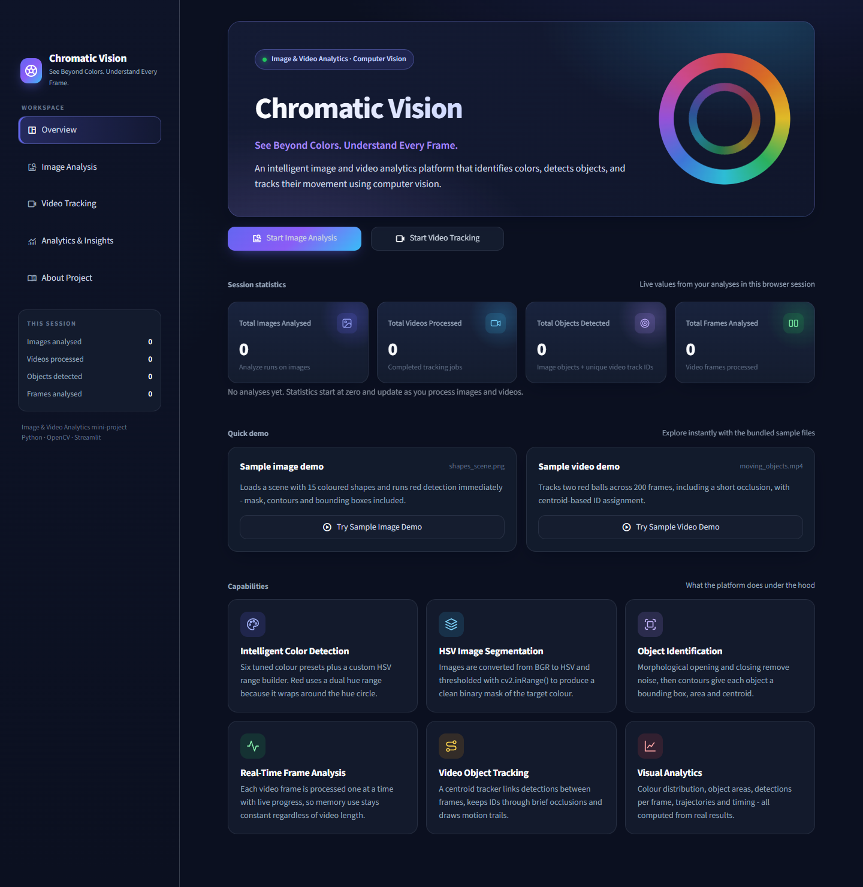

*Figure 3: Overview dashboard with live session statistics, quick demos and feature cards.*

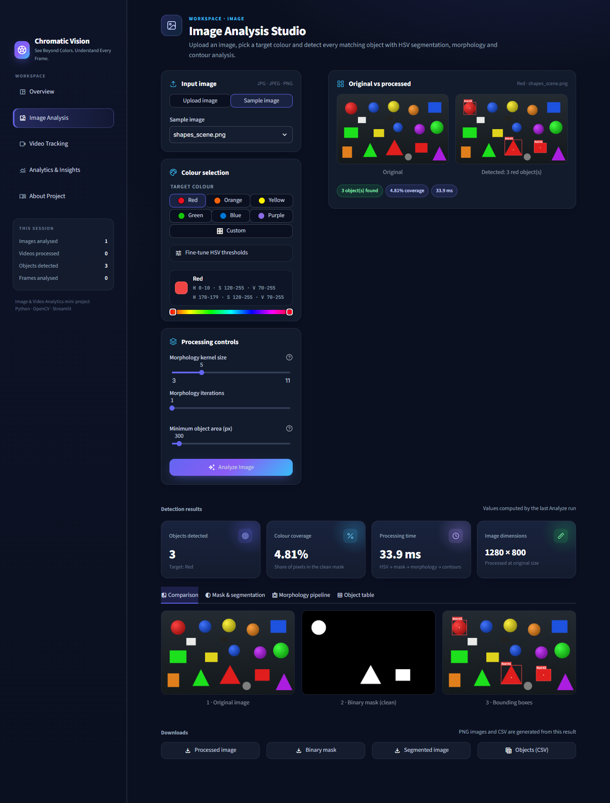

*Figure 4: Image Analysis Studio after running the sample demo (red, shapes_scene.png).*

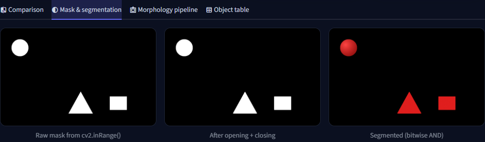

*Figure 5: Raw mask from `cv2.inRange()`, cleaned mask and segmented image.*

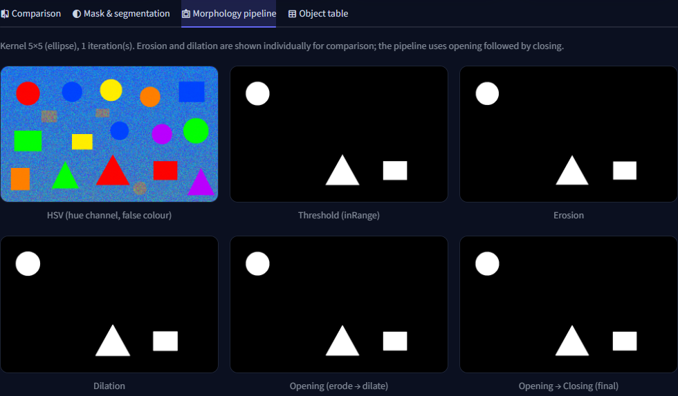

*Figure 6: Every morphological stage shown separately in the application.*

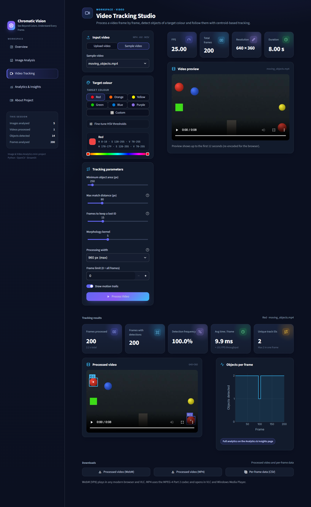

*Figure 7: Video Tracking Studio with video information, preview, tracked output, metrics and downloads.*

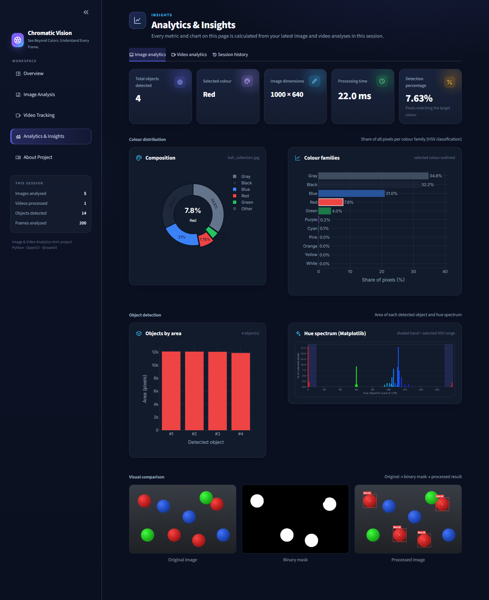

*Figure 8: Analytics for an image run: metrics, colour distribution, object areas and the Matplotlib hue spectrum.*

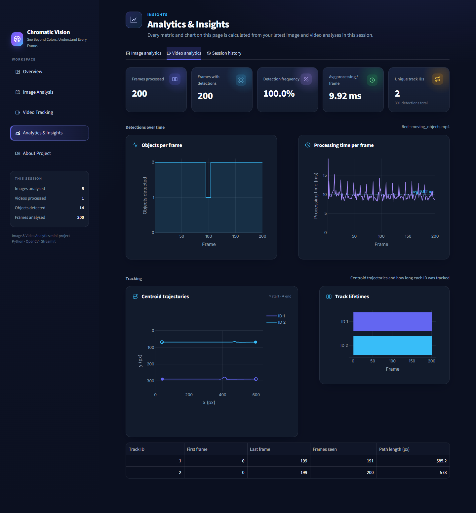

*Figure 9: Video analytics: objects per frame, processing time per frame, trajectories and track lifetimes.*

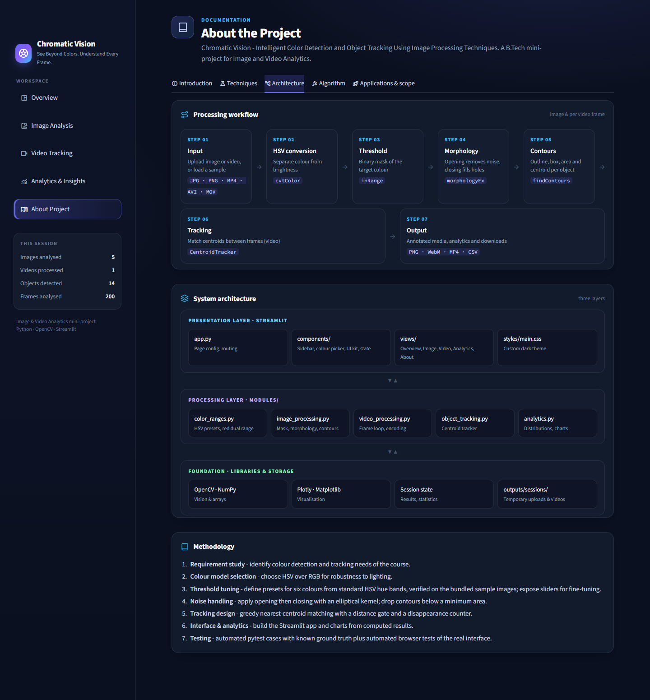

*Figure 10: About Project page with the in-app workflow and architecture diagrams.*

<p align="center">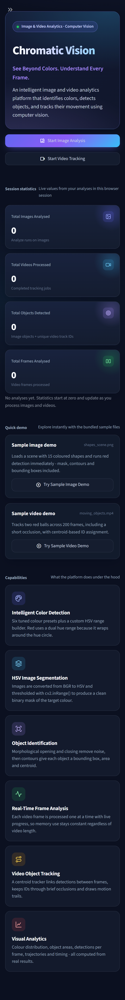</p>

*Figure 11: Responsive layout at phone width (390 px). The sidebar collapses and the cards stack vertically.*

## 14. Results and Discussion

All numbers in this section come from actual runs: `scripts/make_report_assets.py` (stored in `report/figures/measured_results.json`), pytest and the end-to-end script. Processing times differ slightly between runs and machines.

### 14.1 Sample data

The bundled samples are synthetic scenes drawn with OpenCV. They include shaded balls with highlights, flat shapes, neutral distractors (white, grey and black objects) and Gaussian noise. Because they are synthetic, the true number of objects of each colour is known exactly (`assets/sample_ground_truth.json`).

### 14.2 Image detection results

*Table 1: Image detection results with default settings (kernel 5, 1 iteration, minimum area 300 px).*

| Image | Colour | Expected | Detected | Coverage (%) | Time (ms) |
|---|---|---|---|---|---|
| shapes_scene.png (1280×800) | Red | 3 | 3 | 4.81 | 29.5* |
| shapes_scene.png | Orange | 2 | 2 | 2.52 | 7.5 |
| shapes_scene.png | Yellow | 2 | 2 | 2.37 | 8.5 |
| shapes_scene.png | Green | 3 | 3 | 4.90 | 6.6 |
| shapes_scene.png | Blue | 3 | 3 | 3.83 | 7.6 |
| shapes_scene.png | Purple | 2 | 2 | 2.37 | 9.5 |
| ball_collection.jpg (1000×640) | Red | 4 | 4 | 7.63 | 5.6 |
| ball_collection.jpg | Blue | 3 | 3 | 5.93 | 4.5 |
| ball_collection.jpg | Green | 2 | 2 | 3.91 | 4.7 |
| neutral_scene.png | all six | 0 | 0 | 0.00 | – |

\* The first call includes a one-time OpenCV start-up cost. Later calls on the same image take 7–10 ms.

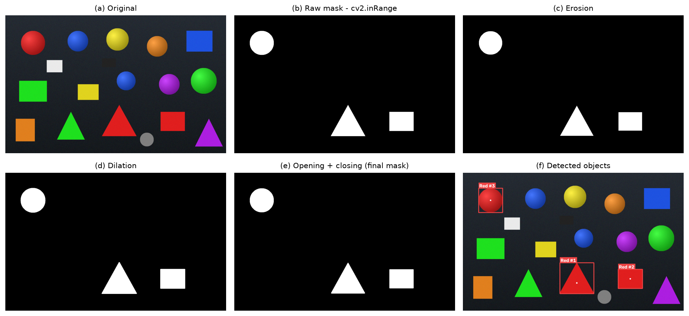

*Figure 12: Pipeline stages for red on shapes_scene.png: (a) original, (b) raw mask, (c) erosion, (d) dilation, (e) final mask, (f) detected objects with IDs and centroids.*

**Discussion.** The detected count equals the ground truth for every colour on both sample images. The neutral distractors (white, grey and black) are never detected. This is because the saturation and value thresholds exclude achromatic pixels, which would not be the case with simple RGB thresholds. The red triangle and rectangle are found together with the shaded red ball, whose hue stays constant while its brightness changes. This shows the benefit of HSV. Because the synthetic scenes have very little noise, the differences between the erosion, dilation and final masks in Figure 12 are small. The unit tests `test_opening_removes_isolated_noise` and `test_closing_fills_hole` show the effect of morphology on noisy masks: 300 salt-noise pixels are removed, and a hole inside an object is filled.

### 14.3 Video tracking results

*Table 2: Video tracking results (processing width ≤ 960 px, minimum area 250, maximum distance 80 px, 15 frames to keep a lost ID).*

| Video | Colour | Frames | Frames with detections | Detection frequency | Unique IDs | Avg ms/frame |
|---|---|---|---|---|---|---|
| moving_objects.mp4 (640×360, 25 fps) | Red | 200 | 200 | 100.0 % | 2 | 9.44 |
| moving_objects.mp4 | Blue | 200 | 200 | 100.0 % | 1 | 8.73 |
| moving_objects.mp4 | Purple (absent) | 200 | 0 | 0.0 % | 0 | 8.22 |
| orbiting_ball.avi (480×360, 30 fps) | Orange | 120 | 120 | 100.0 % | 1 | 9.97 |

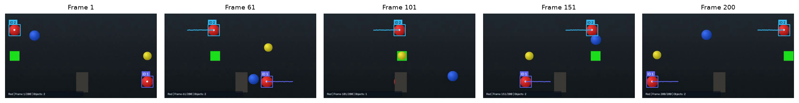

*Figure 13: Frames 1, 61, 101, 151 and 200 of the processed sample video (red). In frame 101 the lower ball (ID 1) is hidden behind the grey pillar. After it reappears it still carries ID 1.*

**Discussion.** The sample video contains two red balls moving in opposite directions. The lower ball passes behind an occluding pillar. The tracker created exactly **2 IDs** for the whole clip. Track 1 was matched in 191 of 200 frames: for 9 frames it was hidden or too small, and it was kept alive by the disappearance counter instead of receiving a new ID. Track 2 was matched in all 200 frames. The objects-per-frame chart (Figure 9) shows this occlusion as a short drop from 2 to 1. With purple, which is absent from the video, the pipeline runs without errors, reports 0 detections and still writes an output video. An average of about 9–10 ms per frame means roughly 100 frames per second on this CPU, which is faster than real time for the sample videos.

### 14.4 Output verification

The processed WebM and MP4 files were opened again with OpenCV, and the number of frames read matched the number of frames processed (`test_output_videos_can_be_opened`). The downloads triggered from the browser were saved and checked for size during the end-to-end run. Example outputs are in `outputs/samples/`: `shapes_scene_red_detected.png`, `shapes_scene_red_mask.png`, `shapes_scene_red_segmented.png`, `moving_objects_red_tracked.webm`, `moving_objects_red_tracked.mp4` and `moving_objects_red_frames.csv`.

## 15. Test Cases

Two kinds of tests were run on the development machine. All results below are copied from actual output (`report/pytest_results.txt` and `report/e2e_results.txt`).

- **Unit tests (pytest):** 34 tests in `tests/`. **Result: 34 passed.**
- **End-to-end UI tests:** `scripts/capture_screenshots.py` controls the real app in Microsoft Edge (headless, using Playwright). It clicks buttons, uploads files and downloads results. **Result: 22/22 checks passed, plus 1/1 mobile layout check.**

*Table 3: Test cases.*

| Test ID | Input | Expected result | Actual result | Pass/Fail |
|---|---|---|---|---|
| TC-01 | Red detection: synthetic image with red at hue 2 and hue 176; sample shapes_scene.png (UI demo) | Both hue ends detected (2 objects); 3 red objects in sample | 2 objects detected; UI shows "Detected: 3 red object(s)" | Pass |
| TC-02 | Blue detection: blue circle on grey; shapes_scene.png in UI | 1 object with centroid at the circle centre (±2 px); 3 blue objects in sample | 1 object, centroid within 2 px; UI shows 3 blue objects | Pass |
| TC-03 | Green detection: green rectangle; ball_collection.jpg in UI | 1 object with exact bounding box; 2 green objects in sample | Box (50, 50, 101×151) as expected; UI shows 2 green objects | Pass |
| TC-04 | Multiple objects: every preset colour on every sample image | Counts equal ground truth (15 colour/image pairs) | All 15 pairs match | Pass |
| TC-05 | No matching colour: white/grey shapes; neutral_scene.png in UI | 0 objects, 0 % coverage, info message, no crash | 0 objects for all colours; UI shows "No green objects were found" | Pass |
| TC-06 | Invalid image: empty bytes, text bytes, truncated PNG; text file renamed to .png uploaded in UI | `ValueError` raised; UI shows "Invalid image" error | ValueError for all three inputs; UI error shown | Pass |
| TC-07 | Video processing: moving_objects.mp4, orbiting_ball.avi, a generated .mov file | Correct info (640×360, 200 frames, 25 fps, 8 s); AVI and MOV processed | Info correct; AVI 120 frames at 30 fps; MOV processed with 1 track | Pass |
| TC-08 | Moving object tracking: two red balls with occlusion | Exactly 2 IDs for the whole clip; at most 2 per frame | 2 unique IDs; both last seen at frame 200; track 1 kept through the occlusion | Pass |
| TC-09 | Processed image download (UI button) | Valid PNG file downloaded | `shapes_scene_red_detected.png` downloaded (> 1 KB); PNG round-trip test passed | Pass |
| TC-10 | Processed video download (WebM and MP4 buttons) | Files download and can be reopened with the correct frame count | Both downloaded (> 10 KB); reopened with 60/60 frames in the unit test | Pass |
| TC-11 | Dashboard statistics after 5 image runs and 1 video run | Overview shows 5 images and 1 video; values change only after real runs | "Total Images Analysed 5", "Total Videos Processed 1" | Pass |
| TC-12 | Navigation: click every sidebar item; demo buttons; empty-state buttons | Each page opens with its heading | All 5 pages opened; demos routed correctly | Pass |
| TC-13 | Video with no detections (purple) | 0 detections, 0 % frequency, output video still created | As expected | Pass |
| TC-14 | Tracker unit behaviour: occlusion of 3 frames, removal after timeout, far detection | ID kept; ID removed; new ID assigned | All 6 tracker tests passed | Pass |
| TC-15 | Corrupt or empty video file | `ValueError` with a message | Raised for both | Pass |
| TC-16 | Large inputs: 4000×3000 image; 1920×1080 video | Image scaled to 1600 px; video scaled to 960×540 | As expected | Pass |
| TC-17 | Responsive layout at 390 px width | No horizontal scrolling; sidebar collapsed | No overflow (Figure 11) | Pass |
| TC-18 | Browser console during the whole UI session | No JavaScript page errors | No errors recorded | Pass |

## 16. Advantages

- Fast: about 5–10 ms per image and about 10 ms per 640×360 frame on a CPU, with no GPU.
- No training data or model files are needed.
- Fully explainable: every intermediate stage can be shown.
- Thresholds can be tuned interactively, and any colour can be defined.
- Correct handling of red through two hue ranges.
- Memory use stays constant for any video length because frames are streamed.
- Results can be exported as PNG, WebM, MP4 and CSV.
- Modern, responsive interface that runs locally with no internet or cloud services.
- Modular code with automated tests.

## 17. Limitations

- Fixed HSV thresholds are sensitive to strong colour casts, very dim light and white-balance changes.
- Touching objects of the same colour merge into a single contour.
- Background areas of the target colour are detected as objects.
- Centroid matching uses only position, so IDs can swap when two same-coloured objects cross closely. It does not predict motion, as a Kalman filter would.
- The sample data is synthetic. Accuracy on real photos depends on threshold tuning and was not measured with a labelled real-world dataset.
- MP4 export uses MPEG-4 Part 2 instead of H.264, because of codec availability in the OpenCV wheel. Some players need the WebM file or VLC.
- Processing uses one CPU thread, so long high-definition videos take time.

## 18. Applications

- Sorting fruit, vegetables or products by colour on conveyor belts.
- Ball tracking in sports analysis and physics laboratory experiments.
- Counting coloured components in quality inspection.
- Tracking colour markers for robotics, drones and gesture input.
- Analysing traffic lights and coloured signs.
- Teaching image processing concepts visually.

## 19. Conclusion

Chromatic Vision shows that a classical pipeline (HSV conversion, `inRange` thresholding, morphological cleaning, contour analysis and centroid tracking) is enough to detect, measure and track colour-defined objects reliably and in real time. The project meets all its objectives. It provides six colour presets plus custom ranges, correct dual-range red detection, configurable morphology, frame-by-frame video tracking with consistent IDs through short occlusions, analytics computed from real results, and downloadable outputs, all in a polished web interface. On the bundled samples the detected counts matched the ground truth exactly, and the tracker kept both red balls' IDs for the full video. All 34 unit tests and all automated UI checks passed. The project also documents its limitations clearly and leaves room for improvements such as motion prediction and separating touching objects.

## 20. Future Enhancements

1. Live webcam processing with `cv2.VideoCapture(0)` or WebRTC.
2. Kalman-filter motion prediction and Hungarian assignment for more robust tracking.
3. Watershed or distance-transform segmentation to separate touching objects.
4. Automatic threshold calibration from a pixel the user clicks on.
5. Adaptive thresholds or histogram equalisation for difficult lighting.
6. Shape classification (circle, rectangle, triangle) using contour approximation.
7. Multi-colour tracking in a single pass.
8. Export of a PDF analysis report from the Analytics page.
9. Optional deep-learning detector for shape-aware recognition.

## 21. References

1. R. C. Gonzalez and R. E. Woods, *Digital Image Processing*, 4th ed., Pearson, 2018.
2. G. Bradski and A. Kaehler, *Learning OpenCV: Computer Vision with the OpenCV Library*, O'Reilly Media, 2008.
3. R. Szeliski, *Computer Vision: Algorithms and Applications*, 2nd ed., Springer, 2022.
4. OpenCV documentation: "Changing Colorspaces", "Morphological Transformations", "Contours: Getting Started", "Contour Features". https://docs.opencv.org/
5. A. R. Smith, "Color Gamut Transform Pairs," *ACM SIGGRAPH Computer Graphics*, vol. 12, no. 3, pp. 12–19, 1978. (Origin of the HSV model.)
6. J. Serra, *Image Analysis and Mathematical Morphology*, Academic Press, 1982.
7. S. Suzuki and K. Abe, "Topological Structural Analysis of Digitized Binary Images by Border Following," *Computer Vision, Graphics, and Image Processing*, vol. 30, no. 1, pp. 32–46, 1985. (Algorithm used by `cv2.findContours`.)
8. Streamlit documentation. https://docs.streamlit.io/
9. Plotly Python documentation. https://plotly.com/python/
10. NumPy documentation. https://numpy.org/doc/

---

### Appendix A – How to run

```
python -m venv .venv
.venv\Scripts\activate
pip install -r requirements.txt
streamlit run app.py
```

### Appendix B – How to reproduce the results

```
pip install -r requirements-dev.txt
python -m pytest tests -v                 # unit tests
python scripts/make_report_assets.py      # figures, measured_results.json, sample outputs
streamlit run app.py                      # in a second terminal:
python scripts/capture_screenshots.py     # end-to-end UI test + screenshots
```
